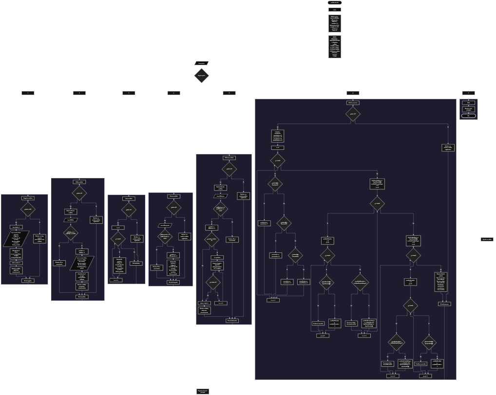

 

Este proyecto, llamado <b>análisis de adn</b>, fue desarrollado en <b>java</b> como un ejercicio práctico para fortalecer la lógica de programación mediante la creación de un sistema de gestión de análisis de ADN desde la consola. El programa cuenta con un menú principal de siete opciones que permite <b>registrar, editar, listar, buscar, eliminar y consultar un resumen</b> de los análisis registrados. Cada análisis almacena información como el nombre de la persona, el código de la muestra, el tipo de muestra, el tipo de análisis, el resultado, la fecha y el estado del análisis, utilizando siete arreglos paralelos con una capacidad máxima de <b>10 registros durante la ejecución</b>. Durante su desarrollo se aplicaron conceptos fundamentales de programación, como variables, arreglos, estructuras condicionales, ciclos repetitivos y estructuras de selección, además de procesos para buscar, modificar, eliminar y organizar registros. También se implementó un resumen que permite identificar los estados registrados, el tipo de muestra más utilizado y el tipo de análisis más realizado. Este proyecto permite poner en práctica los conocimientos adquiridos en Java y sirve como base para desarrollar sistemas de gestión más avanzados utilizando otros lenguajes y tecnologías.

<h2 align="center">⚙️ Funcionamiento del menú principal</h2>

### ➕ Registrar análisis

La opción <b>1) registrar análisis</b> permite almacenar un nuevo análisis en el sistema. Antes de realizar el registro, el programa comprueba que la cantidad de análisis almacenados sea menor a la capacidad del arreglo <b>personas.length</b>, mediante la condición <b>total >= personas.length</b>. Si el arreglo todavía dispone de espacio, genera un identificador utilizando la variable <b>id</b>, cuyo valor corresponde a <b>total + 1</b>. Después, solicita el <b>nombre de la persona, código de la muestra, tipo de muestra, tipo de análisis, resultado del análisis, fecha y estado</b>. Los datos se almacenan en la posición actual de sus respectivos arreglos. Finalmente, muestra el mensaje <b>"análisis registrado correctamente."</b> e incrementa la variable <b>total</b> en uno. Si se alcanza la capacidad máxima de 10 registros, presenta el mensaje <b>"no hay espacio para registrar más análisis."</b>, impidiendo agregar otro registro.

### ✏️ Editar análisis

La opción <b>2) editar análisis</b> permite modificar la información de un análisis registrado. Primero, el programa comprueba si existen análisis almacenados mediante la condición <b>total == 0</b>. Si no hay registros, muestra el mensaje <b>"no existen análisis registrados."</b>. En caso contrario, presenta una lista con el ID, nombre de la persona, código de la muestra, tipo de muestra, tipo de análisis, resultado, fecha y estado de cada registro. Después, solicita el ID del análisis que se desea editar mediante la variable <b>idEditar</b> y comprueba que se encuentre dentro del rango permitido utilizando la condición <b>idEditar >= 1 && idEditar <= total</b>. Si el ID es válido, calcula la posición correspondiente mediante <b>posicion = idEditar - 1</b> y solicita nuevamente los siete datos del análisis. La información introducida actualiza directamente los valores almacenados en los arreglos correspondientes. Finalmente, presenta el mensaje <b>"análisis actualizado correctamente."</b>. Si el ID no corresponde a un registro existente, muestra el mensaje <b>"ID no encontrada."</b>.

### 📋 Listar análisis

La opción <b>3) listar análisis</b> permite visualizar todos los análisis registrados actualmente en el sistema. Antes de mostrar la información, el programa comprueba si la variable <b>total</b> es igual a cero. Si no existen registros, presenta el mensaje <b>"no existen análisis registrados."</b>. Si hay análisis disponibles, utiliza un ciclo <b>for</b> para recorrer los arreglos desde la primera posición hasta el total de registros almacenados. Durante el recorrido, muestra el ID, nombre de la persona, código de la muestra, tipo de muestra, tipo de análisis, resultado, fecha y estado de cada análisis. El identificador se obtiene mediante la expresión <b>i + 1</b>. Esta función facilita consultar todos los registros existentes sin necesidad de buscar cada análisis individualmente.

### 🔎 Buscar análisis

La opción <b>4) buscar análisis</b> permite localizar un registro mediante su ID. Primero, el programa comprueba si existen análisis registrados mediante la condición <b>total == 0</b>. Si el sistema está vacío, muestra el mensaje <b>"no existen análisis registrados."</b>. En caso contrario, solicita el identificador que se desea buscar y lo almacena en la variable <b>idBusqueda</b>. Después, comprueba que el ID se encuentre entre <b>1</b> y el valor actual de <b>total</b>. Si la selección es válida, obtiene la posición correspondiente mediante <b>posicion = idBusqueda - 1</b> y muestra todos los datos del análisis encontrado: nombre de la persona, código de la muestra, tipo de muestra, tipo de análisis, resultado, fecha y estado. Si el ID introducido no corresponde a un registro existente, presenta el mensaje <b>"ID no encontrada."</b>. La búsqueda se realiza mediante el identificador del registro y no mediante el nombre de la persona o el código de la muestra.

### 🗑️ Eliminar análisis

La opción <b>5) eliminar análisis</b> permite eliminar un registro mediante su ID. Antes de comenzar, el programa comprueba si existen análisis almacenados. Si no hay registros, muestra el mensaje <b>"no existen análisis registrados."</b>. Si existen datos, presenta una lista con la información de todos los análisis y solicita el ID que se desea eliminar mediante la variable <b>idEliminar</b>. Después, verifica que el identificador se encuentre dentro del rango permitido. Si es válido, calcula la posición correspondiente utilizando <b>posicion = idEliminar - 1</b> y comienza el proceso de eliminación. Para mantener los registros organizados, utiliza un ciclo <b>for</b> controlado por la variable <b>i</b>, que desplaza una posición hacia atrás los datos de los registros posteriores en los siete arreglos: <b>personas, codigosMuestra, tiposMuestra, tiposAnalisis, resultados, fechas y estados</b>. Posteriormente, disminuye la variable <b>total</b> en uno y muestra el mensaje <b>"análisis eliminado correctamente."</b>. Si el ID seleccionado no corresponde a un registro existente, presenta el mensaje <b>"ID no encontrada."</b>.

### 📊 Mostrar resumen

La opción <b>6) mostrar resumen</b> permite consultar información estadística sobre los análisis registrados. Primero, el programa comprueba si existen registros mediante la condición <b>total == 0</b>. Si no hay análisis almacenados, muestra el mensaje <b>"no existen análisis registrados."</b>. En caso contrario, inicializa cuatro contadores: <b>pendientes, procesados, cancelados y otrosEstados</b>. Después, utiliza un ciclo <b>for</b> para recorrer los estados almacenados en el arreglo <b>estados</b> y clasificarlos mediante las comparaciones <b>equalsIgnoreCase("Pendiente")</b>, <b>equalsIgnoreCase("Procesado")</b> y <b>equalsIgnoreCase("Cancelado")</b>. Los estados que no coinciden con estas categorías se contabilizan como otros estados.

A continuación, el programa determina el tipo de muestra más utilizado mediante las variables <b>tipoMuestraMayor, cantidadMuestraMayor y cantidadMuestra</b>. Para ello, utiliza dos ciclos <b>for</b> que comparan cada elemento del arreglo <b>tiposMuestra</b> con los demás registros, contabilizando las coincidencias mediante <b>equalsIgnoreCase()</b>. Cuando encuentra una frecuencia superior a la almacenada, actualiza la cantidad máxima y el tipo de muestra correspondiente. Posteriormente, realiza un procedimiento similar para identificar el tipo de análisis más realizado, utilizando las variables <b>tipoAnalisisMayor, cantidadAnalisisMayor y cantidadAnalisis</b> y comparando los valores del arreglo <b>tiposAnalisis</b>.

Finalmente, muestra el total de análisis registrados, el tipo de muestra más utilizado, el tipo de análisis más realizado y las cantidades de análisis pendientes, procesados, cancelados y otros estados. En caso de que existan varios valores con la misma frecuencia máxima, el programa conserva el primero que alcanzó esa cantidad, debido a que las actualizaciones se realizan únicamente cuando se encuentra una cantidad estrictamente mayor.

### 🚪 Salir del menú principal

La opción <b>7) salir</b> está destinada a finalizar la ejecución del programa y muestra el mensaje <b>"gracias por utilizar análisis de adn."</b>. El menú principal se encuentra dentro de una estructura repetitiva <b>do-while</b>, que mantiene el programa en funcionamiento mientras la variable <b>opcion</b> sea diferente de <b>7</b>. Cuando el usuario selecciona esta opción, el ciclo termina y se ejecuta <b>entrada.close()</b>, cerrando el objeto utilizado para recibir los datos introducidos por el usuario.

<h2 align="center">🧠 Temas aplicados en el proyecto</h2>

### 📦 Variables

En este proyecto se utilizan variables para controlar la opción seleccionada en el menú, almacenar la cantidad de análisis registrados, generar identificadores, seleccionar la posición de los registros que se desean editar, buscar o eliminar, recorrer los arreglos y realizar los cálculos necesarios para generar el resumen estadístico. También se utilizan variables para contabilizar los estados, las frecuencias de los tipos de muestra y los tipos de análisis. Cada variable cumple una función específica dentro de las operaciones de gestión de análisis de ADN.

🔢 **entrada:** Objeto de la clase `Scanner` utilizado para recibir los datos introducidos por el usuario.

🔢 **total:** Almacena la cantidad actual de análisis registrados.

🔢 **opcion:** Almacena la opción seleccionada por el usuario en el menú principal.

🆔 **id:** Genera el identificador del nuevo análisis mediante la expresión `total + 1`.

✏️ **idEditar:** Almacena el ID del análisis que se desea modificar.

🔎 **idBusqueda:** Almacena el ID del análisis que se desea buscar.

🗑️ **idEliminar:** Almacena el ID del análisis que se desea eliminar.

📍 **posicion:** Determina el índice del arreglo correspondiente al ID seleccionado.

🔄 **i:** Funciona como contador en los ciclos `for` y permite recorrer los registros almacenados.

🔁 **j:** Controla el segundo recorrido utilizado para comparar los tipos de muestra y los tipos de análisis.

📊 **pendientes:** Cuenta los análisis cuyo estado corresponde a pendiente.

📊 **procesados:** Cuenta los análisis cuyo estado corresponde a procesado.

📊 **cancelados:** Cuenta los análisis cuyo estado corresponde a cancelado.

📊 **otrosEstados:** Cuenta los análisis cuyos estados no coinciden con las tres categorías anteriores.

🧪 **tipoMuestraMayor:** Almacena el tipo de muestra que aparece con mayor frecuencia.

🔢 **cantidadMuestraMayor:** Guarda la mayor cantidad de coincidencias encontrada entre los tipos de muestra.

🔄 **cantidadMuestra:** Cuenta las coincidencias del tipo de muestra que se está comparando.

🧬 **tipoAnalisisMayor:** Almacena el tipo de análisis que aparece con mayor frecuencia.

🔢 **cantidadAnalisisMayor:** Guarda la mayor cantidad de coincidencias encontrada entre los tipos de análisis.

🔄 **cantidadAnalisis:** Cuenta las coincidencias del tipo de análisis que se está comparando.

### 🗃️ Arreglos

En este proyecto se utilizan siete arreglos relacionados con la información de cada análisis de ADN. Todos tienen una capacidad de <b>10 posiciones</b> y utilizan el mismo índice para representar los datos correspondientes a un mismo registro. Por ejemplo, la información de un análisis almacenado en la posición <b>0</b> se encuentra distribuida entre <b>personas[0], codigosMuestra[0], tiposMuestra[0], tiposAnalisis[0], resultados[0], fechas[0] y estados[0]</b>. Esta organización permite recorrer, buscar, modificar, mostrar, eliminar y comparar los registros de manera ordenada.

🧑 **personas[10]:** Almacena los nombres de las personas relacionadas con los análisis registrados.

🧪 **codigosMuestra[10]:** Almacena los códigos correspondientes a las muestras.

🔬 **tiposMuestra[10]:** Almacena los tipos de muestras utilizadas en los análisis.

🧬 **tiposAnalisis[10]:** Almacena los tipos de análisis realizados.

📄 **resultados[10]:** Almacena los resultados registrados para cada análisis.

📅 **fechas[10]:** Almacena las fechas correspondientes a los análisis.

📊 **estados[10]:** Almacena los estados de los análisis, como pendiente, procesado o cancelado.

### 🔀 Estructuras condicionales

En este proyecto se utilizan las estructuras <b>if, else if y else</b> para comprobar si existe espacio disponible antes de registrar un análisis, verificar si hay registros antes de ejecutar determinadas operaciones, validar los identificadores introducidos durante la edición, búsqueda y eliminación, y clasificar los estados de los análisis. También se utilizan condiciones para comparar las frecuencias de los tipos de muestra y los tipos de análisis, permitiendo actualizar los valores que aparecen con mayor frecuencia. Estas estructuras permiten que el programa responda de manera diferente según el estado de los registros y el resultado de cada comparación.

### 🔄 Estructuras repetitivas

En este proyecto se utilizan las estructuras repetitivas <b>do-while</b> y <b>for</b>. El ciclo <b>do-while</b> mantiene activo el menú principal y permite ejecutar diferentes operaciones hasta que el usuario selecciona la opción <b>7</b>. Por otro lado, los ciclos <b>for</b> permiten recorrer los arreglos para mostrar los análisis registrados, realizar comparaciones y acceder a los datos almacenados. También se utilizan durante la eliminación para desplazar los registros posteriores una posición hacia atrás. En la opción de resumen, los ciclos <b>for</b> anidados permiten comparar los tipos de muestra y los tipos de análisis para determinar cuáles aparecen con mayor frecuencia.

### 🎯 Estructura switch

El programa utiliza la estructura <b>switch</b> para evaluar el valor almacenado en la variable <b>opcion</b> y ejecutar el bloque de instrucciones correspondiente. Cada caso representa una operación específica del sistema: <b>registrar, editar, listar, buscar, eliminar, mostrar resumen o salir</b>. También se utiliza el bloque <b>default</b> para mostrar el mensaje <b>"opción no válida."</b> cuando el usuario introduce un número que no coincide con ninguna de las opciones definidas en el menú. La instrucción <b>break</b> permite finalizar cada caso y evitar que se ejecuten las instrucciones de las opciones siguientes.

### 🔢 Dimensionamiento de arreglos

El programa utiliza la creación de arreglos mediante la instrucción <b>new String[10]</b> para establecer la capacidad de almacenamiento de la información de los análisis. Se definieron <b>10 posiciones</b> para cada uno de los siete arreglos, lo que permite administrar hasta 10 registros durante la ejecución. La cantidad de posiciones ocupadas se controla mediante la variable <b>total</b>, por lo que las operaciones recorren únicamente los registros comprendidos entre la primera posición y el total actual de análisis almacenados.

### 🔄 Reorganización de registros

Cuando se selecciona un análisis para eliminarlo, el programa utiliza un ciclo <b>for</b> que comienza en la posición seleccionada y continúa mientras <b>i &lt; total - 1</b>. En cada repetición, los datos de la posición siguiente se copian sobre la posición actual en los siete arreglos: <b>personas, codigosMuestra, tiposMuestra, tiposAnalisis, resultados, fechas y estados</b>. Después, la variable <b>total</b> disminuye en uno. De esta manera, los registros posteriores ocupan las posiciones disponibles y se mantiene organizada la información almacenada. El programa no limpia explícitamente la última posición después del desplazamiento, pero esta queda fuera del rango de registros activos controlado por <b>total</b>.

<h2 align="center">¿Cómo se implementaron las operaciones crud en el proyecto?</h2>

Las operaciones <b>crud</b> se implementaron mediante las opciones del menú principal, permitiendo administrar los análisis registrados. La operación <b>crear</b> corresponde a <b>registrar análisis</b>, donde se introducen los datos de una nueva persona y su muestra; <b>leer</b> se realiza mediante las opciones <b>buscar análisis, listar análisis y mostrar resumen</b>, que permiten consultar los registros y obtener información estadística; <b>actualizar</b> corresponde a <b>editar análisis</b>, donde se modifican los datos de un registro existente; y <b>eliminar</b> se realiza mediante la opción <b>eliminar análisis</b>, que permite retirar un registro y reorganizar los datos de los arreglos. Estas operaciones utilizan variables, arreglos, estructuras condicionales y ciclos repetitivos para gestionar la información almacenada temporalmente durante la ejecución del programa.

<h2 align="center">Diagrama de flujo del proyecto</h2>

<h2 align="center">🛡️ Validaciones del programa</h2>

### 📭 No existen análisis registrados

Esta validación se utiliza en las opciones de <b>editar, buscar, eliminar y mostrar resumen</b>, además de la opción de listado. El programa comprueba si la variable <b>total</b> es igual a <b>0</b> y, si no existen análisis registrados, muestra el mensaje <b>"no existen análisis registrados."</b>. Esta comprobación evita continuar con las operaciones que necesitan información almacenada cuando el sistema está vacío.

### ⚠️ Capacidad máxima de registros

Esta validación se utiliza durante el registro de nuevos análisis para controlar la capacidad máxima de los arreglos. El programa comprueba si <b>total >= personas.length</b> antes de permitir agregar un nuevo registro. Si todavía existe espacio disponible, genera el identificador correspondiente y solicita los datos del análisis. En caso contrario, muestra el mensaje <b>"no hay espacio para registrar más análisis."</b>, impidiendo almacenar registros que superen las 10 posiciones disponibles.

### 🔢 Selección de análisis

El programa utiliza las variables <b>idEditar, idBusqueda e idEliminar</b> para identificar el análisis que se desea modificar, buscar o eliminar. Antes de ejecutar estas operaciones, comprueba que el identificador sea mayor o igual a <b>1</b> y menor o igual al valor de <b>total</b>, mediante la condición <b>id >= 1 && id <= total</b>, utilizando la variable correspondiente a cada operación. Si el ID se encuentra dentro del rango permitido, calcula la posición del arreglo restando uno al identificador. Si no corresponde a un registro existente, muestra el mensaje <b>"ID no encontrada."</b>.

### 📊 Clasificación de estados

Esta comprobación se utiliza en la opción <b>mostrar resumen</b> para clasificar los estados de los análisis. El programa compara cada valor del arreglo <b>estados</b> mediante el método <b>equalsIgnoreCase()</b>, identificando los estados <b>"Pendiente", "Procesado" y "Cancelado"</b>. Si un estado no coincide con ninguna de estas categorías, se contabiliza dentro de la variable <b>otrosEstados</b>. De esta manera, todos los registros se incluyen en alguna de las categorías del resumen.

### 🔎 Comparación de tipos de muestra y análisis

El programa utiliza comparaciones mediante <b>equalsIgnoreCase()</b> para determinar el tipo de muestra más utilizado y el tipo de análisis más realizado. Para ello, recorre los arreglos correspondientes y cuenta las coincidencias entre sus elementos. Cuando encuentra una cantidad superior a la frecuencia máxima almacenada, actualiza el tipo correspondiente y su contador. Si existen varios valores con la misma frecuencia máxima, conserva el primero que alcanzó dicha cantidad, debido a que la condición utilizada es una comparación estricta de mayor que.

### ⚠️ Opción inválida

La estructura <b>switch</b> incluye el bloque <b>default</b>, que muestra el mensaje <b>"opción no válida."</b> cuando el usuario introduce un número que no corresponde a ninguna de las siete opciones definidas en el menú principal. Esta comprobación permite informar al usuario cuando selecciona una opción que no está disponible.

### ⚠️ Entrada de datos

El programa utiliza el objeto <b>entrada</b> de la clase <b>Scanner</b> para recibir los datos introducidos por el usuario. Las opciones del menú y los identificadores se leen mediante <b>nextInt()</b>, mientras que los datos de texto se reciben mediante <b>nextLine()</b>. Después de utilizar <b>nextInt()</b>, se ejecuta <b>nextLine()</b> para consumir el salto de línea pendiente. Sin embargo, el programa no incorpora una validación para entradas no numéricas en los campos que utilizan <b>nextInt()</b>, por lo que introducir texto en estos campos puede provocar una excepción de entrada. Tampoco comprueba que los campos de texto estén completos ni valida formatos específicos para las fechas, códigos o resultados.

<h2 align="center">🎯 Objetivo del proyecto</h2>

El objetivo principal de este proyecto es fortalecer la <b>lógica de programación</b> mediante el desarrollo de un sistema de gestión de análisis de ADN en <b>java</b>. A través de su construcción se busca aplicar los conocimientos adquiridos sobre variables, arreglos, estructuras condicionales, ciclos repetitivos y estructuras de selección, integrándolos para resolver un problema de manera organizada. Además, el proyecto permite comprender cómo registrar, consultar, modificar y eliminar información en una aplicación de consola, así como realizar comparaciones y generar resúmenes estadísticos a partir de los datos almacenados. De esta manera, se establece una base para desarrollar sistemas de gestión más completos utilizando otros lenguajes y tecnologías.

